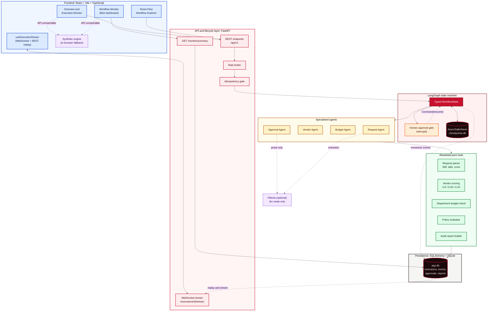
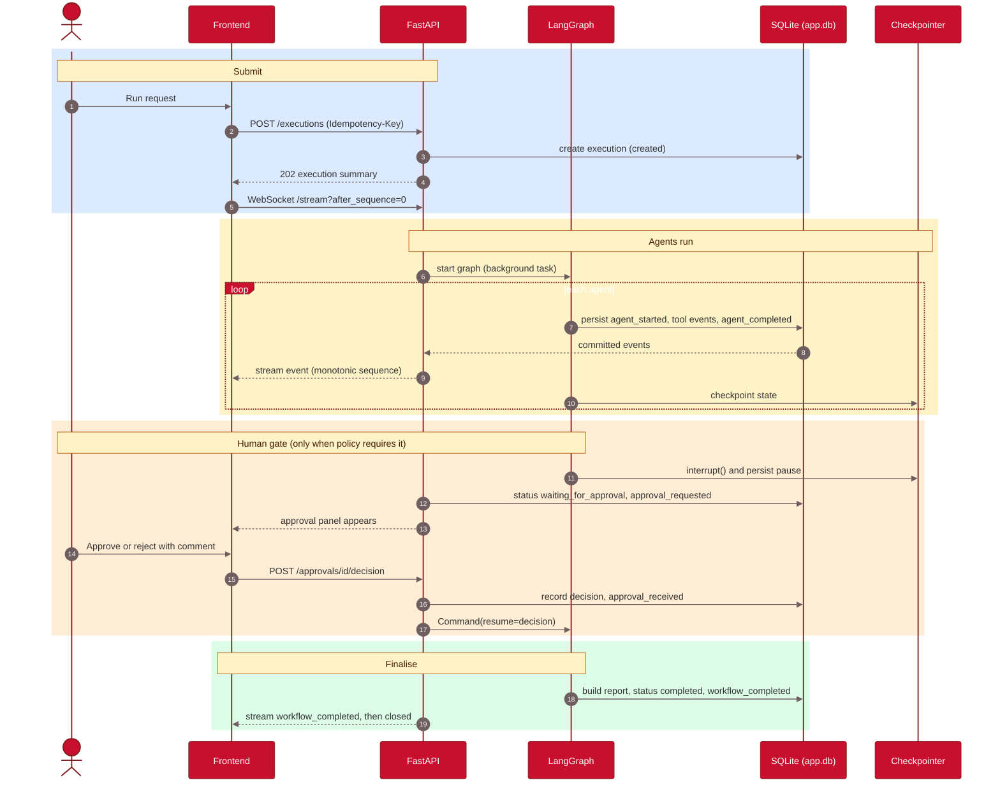
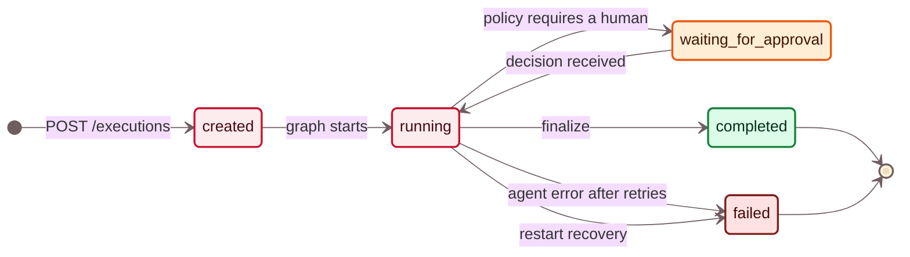
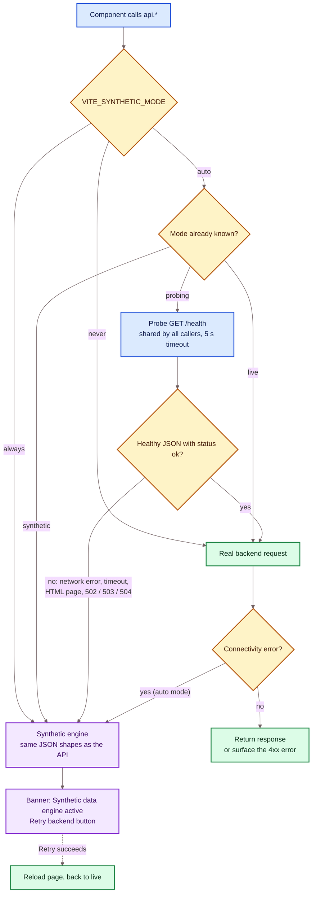
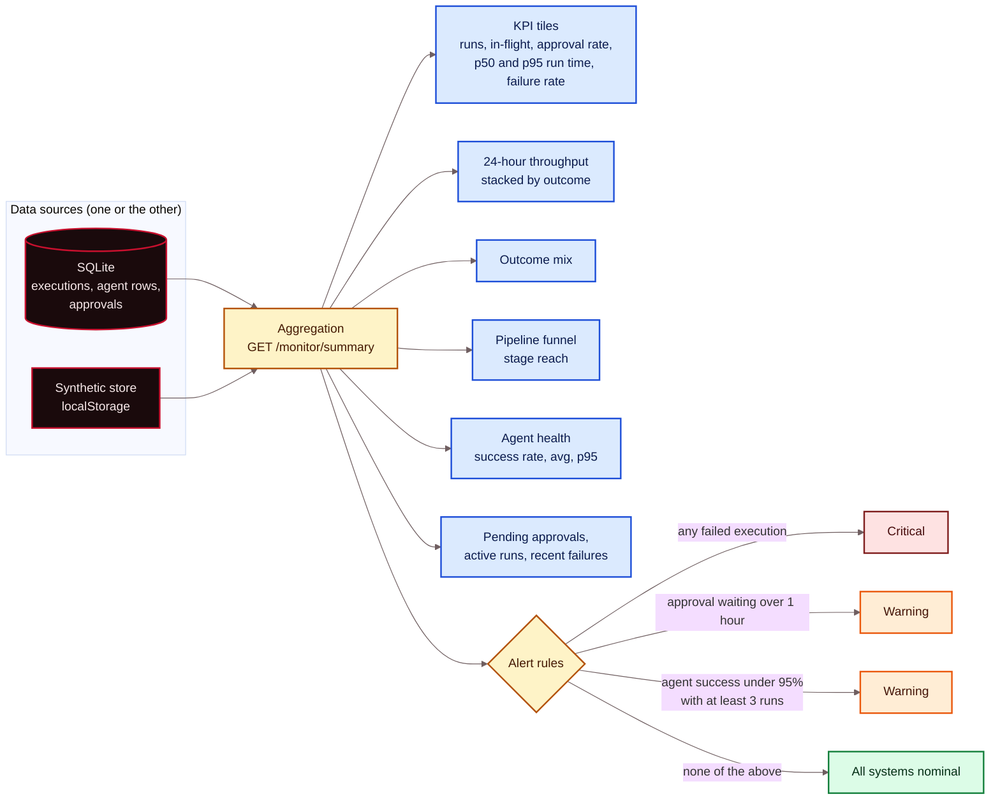
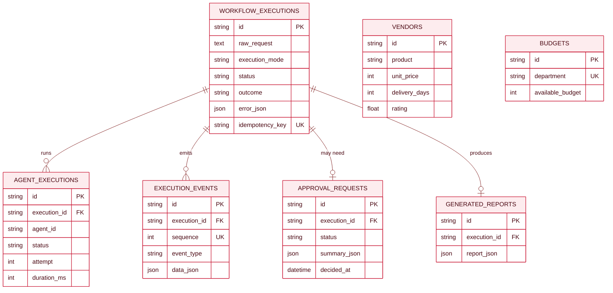
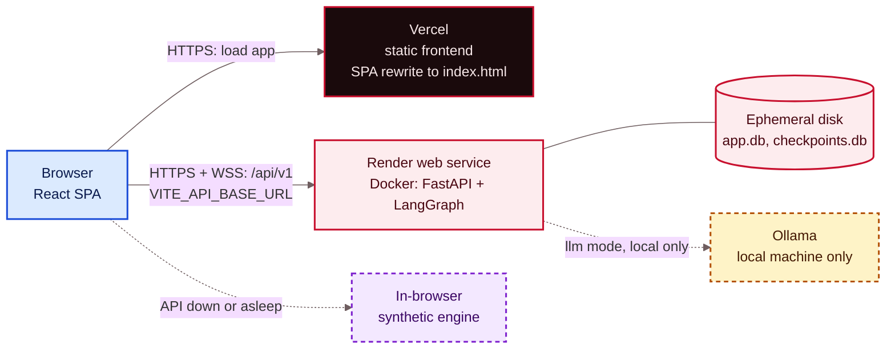

# AgentOps: Multi-Agent Workflow Operations

[](https://agentops-project1.vercel.app/)
[](https://fastapi.tiangolo.com)
[](https://langchain-ai.github.io/langgraph/)
[](https://react.dev/)
[](https://www.typescriptlang.org/)
[](https://www.docker.com/)
[]()
[](LICENSE)

**AgentOps** is an enterprise-grade, multi-agent workflow orchestration platform built for high-stakes business automation. Powered by **LangGraph**, **FastAPI**, and **React Flow**, it shows how to coordinate autonomous AI agents with **deterministic financial guardrails**, **fault-tolerant human-in-the-loop approval gates**, **restart-resilient state checkpointing**, **real-time WebSocket event streaming**, and a **fleet-level Workflow Monitor**.

> **Live Demo:** [https://agentops-project1.vercel.app/](https://agentops-project1.vercel.app/)
> All catalog vendors, pricing, and departmental budgets are synthetic. No real financial transactions are executed.

---

## Table of Contents

1. [Engineering Highlights](#engineering-highlights)
2. [What's New in AgentOps](#whats-new-in-agentops)
3. [System Architecture](#system-architecture)
4. [The Multi-Agent Pipeline](#the-multi-agent-pipeline)
5. [Execution Lifecycle](#execution-lifecycle)
6. [Execution State Machine](#execution-state-machine)
7. [Synthetic Fallback Engine](#synthetic-fallback-engine)
8. [Workflow Monitor](#workflow-monitor)
9. [Data Model](#data-model)
10. [Deployment Topology](#deployment-topology)
11. [Quick Start](#quick-start-run-locally)
12. [Verification Scenarios](#verification-scenarios-end-to-end)
13. [Test Suite](#test-suite)
14. [Environment Configuration](#environment-configuration)
15. [Project Structure](#project-structure)
16. [Documentation](#deep-dive-technical-documentation)
17. [Trade-Offs and Limitations](#engineering-trade-offs-and-honest-limitations)

---

## Engineering Highlights

Autonomous multi-agent systems often suffer from non-deterministic outputs, hallucinated calculations, and fragile state management. AgentOps addresses these with the following design choices.

- **100% deterministic financial calculations.** The LLM is never permitted to calculate prices, delivery scores, tax, budget subtractions, or approval policy routing. All business math and scoring formulas run in pure, unit-tested code.
- **Durable human-in-the-loop (`interrupt()`).** If a purchase exceeds policy thresholds (more than ₹5,00,000, or less than 10% of the department budget remaining), the workflow pauses. Execution state is persisted to an SQLite checkpointer (`checkpoints.db`). The server can restart or crash and the approval will still be waiting to resume.
- **Dual execution engine (`demo` and `llm`).**
  - `demo` mode (default): fully offline, no external dependencies or API keys. Deterministic regex parsing for Indian financial formats (`₹8,00,000`, `8 lakh`, `1.2 crore`).
  - `llm` mode (optional): local **Ollama** (`llama3.1:8b`) for structured JSON extraction and report prose, with retry logic.
- **Persist-then-publish streaming.** Every agent action, tool invocation, and routing branch is committed to SQLite with a monotonic sequence number before it is published over WebSockets. A client that disconnects or refreshes replays missed events by sequence, with no loss or duplication.
- **Dynamic graph discovery.** The React Flow visualization is not hardcoded. It queries `GET /api/v1/workflows/procurement` and renders the compiled LangGraph topology.
- **Graceful degradation.** If the API is unreachable, an in-browser synthetic engine runs the same workflow, so the application never shows a dead screen.

---

## What's New in AgentOps

| Feature | Description |
|---|---|
| **Workflow Monitor** (`/workflow-monitor`) | Fleet-level dashboard: KPIs, 24-hour throughput, outcome mix, pipeline funnel, per-agent health, pending approvals, active runs, recent failures, and derived alerts. Refreshes every 3 seconds. Backed by `GET /api/v1/monitor/summary`. |
| **Synthetic fallback engine** | When the API is unreachable, times out, or returns non-JSON (for example a static host's SPA fallback), the frontend switches to an in-browser engine that runs the same workflow with the same deterministic rules, event stream, approval pause and resume, and a seeded 24-hour history. A banner shows the active data source, with a Retry backend button. |
| **Fault simulator** | In synthetic mode, a "Simulate agent failure" sample injects a retryable tool timeout into the Vendor Agent so failure paths can be demonstrated. |
| **Red theme** | All colours come from design tokens in `frontend/src/index.css`. |

| Frontend variable (build time) | Default | Meaning |
|---|---|---|
| `VITE_SYNTHETIC_MODE` | `auto` | `auto` falls back when the API is down. `always` never calls the API (static demo). `never` fails loudly. |
| `VITE_API_TIMEOUT_MS` | `5000` | How long to wait for the API before falling back. |

> The backend's `llm` mode is unchanged: LLM failures still surface visibly (see `docs/decisions.md`). Only an unreachable API triggers the synthetic engine.

---

## System Architecture

Colour key: blue is the client, red is the API layer, solid crimson is the orchestrator, amber is agents, green is tools, charcoal is storage, purple is the synthetic engine.



---

## The Multi-Agent Pipeline

The procurement lifecycle is split into four isolated agents extending a strict `BaseAgent` contract with Pydantic validation. Conditional edges route invalid requests and policy-clean requests straight to the final report.

```mermaid
%%{init: {"theme":"base","themeVariables":{"fontFamily":"Inter, Segoe UI, sans-serif","lineColor":"#6F5E60"}}}%%
flowchart LR
    classDef edge fill:#1A0A0C,stroke:#1A0A0C,color:#F6E7E8
    classDef orch fill:#C8102E,stroke:#7F1D1D,stroke-width:2px,color:#FFFFFF
    classDef agent fill:#FEF3C7,stroke:#B45309,stroke-width:2px,color:#451A03
    classDef human fill:#FFEDD5,stroke:#EA580C,stroke-width:3px,color:#431407
    classDef report fill:#DCFCE7,stroke:#15803D,stroke-width:2px,color:#052E16

    START(["Start"]):::edge --> init["init<br/>Orchestrator"]:::orch
    init --> request_agent["Request Agent<br/>parse and validate"]:::agent

    request_agent -- "valid" --> vendor_agent["Vendor Agent<br/>score vendors"]:::agent
    request_agent -- "invalid" --> finalize

    vendor_agent --> budget_agent["Budget Agent<br/>check department budget"]:::agent
    budget_agent --> approval_agent["Approval Agent<br/>apply policy"]:::agent

    approval_agent -- "above 5 lakh or under 10% left" --> human_review{{"Human Review<br/>interrupt()"}}:::human
    approval_agent -- "auto-approved or budget rejection" --> finalize

    human_review -- "approve or reject" --> finalize["Final Report<br/>deterministic audit"]:::report
    finalize --> END(["End"]):::edge

    linkStyle 2 stroke:#B45309,stroke-width:2px,stroke-dasharray:5 4
    linkStyle 3 stroke:#B45309,stroke-width:2px,stroke-dasharray:5 4
    linkStyle 6 stroke:#EA580C,stroke-width:3px
    linkStyle 7 stroke:#B45309,stroke-width:2px,stroke-dasharray:5 4
    linkStyle 8 stroke:#EA580C,stroke-width:3px
```



### Agent Roster and Responsibility Matrix

| Agent | Responsibilities | Tools used | Deterministic vs. LLM |
|---|---|---|---|
| **1. Request Agent** | Extracts quantity, product, department, and maximum budget from raw text. Validates against catalogs. | None (internal parser) | **Demo:** regex and Indian currency normaliser. **LLM:** Ollama JSON schema extraction. |
| **2. Vendor Agent** | Evaluates vendor candidates within budget. Normalises price, delivery, and rating to score quotes. | `get_vendors` | **Scoring:** 0.60 x (1 - price) + 0.25 x (1 - delivery) + 0.15 x rating, min-max normalised. **LLM:** 2-3 sentence justification prose. |
| **3. Budget Agent** | Verifies department budget allocation, remaining funds, and request maximums. | `get_department_budget`, `calculate_budget_check` | **Pure arithmetic** in every mode. |
| **4. Approval Agent** | Applies compliance policy. Auto-rejects budget overruns; flags requests above ₹5,00,000 for human review. | `evaluate_policy` | **Policy engine:** deterministic rules. **LLM:** executive summary prose. |

---

## Execution Lifecycle

A request travels from the browser through the API into the graph. Events are persisted before they are published, and a human decision resumes the graph from its checkpoint.



---

## Execution State Machine



| Final outcome | Meaning |
|---|---|
| `approved` | Auto-approved within policy, or approved by a human |
| `rejected` | Budget rejection, no eligible vendor, or rejected by a human |
| `failed_validation` | The request could not be parsed or validated |
| `error` | An agent or the orchestrator failed |

---

## Synthetic Fallback Engine

Every API call goes through one decision point. A health probe runs first and every request waits for the same answer. Once the engine takes over, no network calls are made until you retry.



What the synthetic engine reproduces:

| Capability | Behaviour |
|---|---|
| Deterministic rules | Parser, vendor scoring, budget and policy checks ported line for line from the backend |
| Event stream | Same event types, monotonic sequence numbers, replay after a sequence |
| Human approval | Pauses at `waiting_for_approval`, resumes on decision, rejects double decisions with 409 |
| Persistence | `localStorage`, so a refresh behaves like the real backend; interrupted runs become failed on reload |
| Seed history | 16 historical runs on first load, including approvals, rejections, a failure, and one stale pending approval |
| Fault injection | Requests containing "simulate failure" fail the Vendor Agent with a retryable `ToolTimeoutError` |

---

## Workflow Monitor

The monitor aggregates every execution into one operational view. The same response shape is produced by the backend (`monitor_service.py`) and by the synthetic engine (`synthetic/monitor.ts`).



Notes on the numbers:

- **Automated run time** covers only runs that needed no human review, so approval waits do not distort latency. Approval wait is reported separately.
- **Percentiles** use the nearest-rank method.
- **Pipeline funnel** counts how many runs reached each stage; invalid requests never reach the Vendor Agent.

---

## Data Model



Seed data: 8 vendors (laptops, monitors, keyboards) and 4 departmental budgets (Engineering ₹12L, Finance ₹6L, Marketing ₹4L, HR ₹2.5L). Vendors and budgets are reference tables looked up by tools, not foreign-keyed to executions.

---

## Deployment Topology



| Piece | Platform | Key settings |
|---|---|---|
| Frontend | Vercel (root `frontend`, Vite preset) | `VITE_API_BASE_URL`, `VITE_SYNTHETIC_MODE` |
| Backend | Render web service (root `backend`, Docker) | `EXECUTION_MODE=demo`, `CORS_ORIGINS=<vercel url>`, health check `/api/v1/health` |
| Static-only demo | Vercel alone | `VITE_SYNTHETIC_MODE=always` |

Full steps are in [docs/demo-guide.md](docs/demo-guide.md).

---

## Quick Start (Run Locally)

### Option 1: Docker Compose (recommended)

```bash
docker compose up --build
```

- **Frontend:** [http://localhost:5173](http://localhost:5173)
- **OpenAPI docs:** [http://localhost:8000/docs](http://localhost:8000/docs)
- **Health check:** [http://localhost:8000/api/v1/health](http://localhost:8000/api/v1/health)

### Option 2: Native development

Prerequisites: Python 3.10+ and Node.js 20+ with npm.

**Backend**

```bash
cd backend
python -m venv .venv
source .venv/bin/activate       # Windows PowerShell: .venv\Scripts\Activate.ps1
pip install -r requirements-dev.txt

# Migrates SQLite and seeds reference data on startup
uvicorn app.main:app --reload --port 8000
```

**Frontend** (separate terminal)

```bash
cd frontend
npm install
npm run dev
```

Open [http://localhost:5173](http://localhost:5173). To see the synthetic engine, stop the backend and reload: the banner appears and everything keeps working.

---

## Verification Scenarios (End-to-End)

The following scenarios cover every path through the state graph. They behave identically on the real backend and in the synthetic engine.

| # | Request | Outcome | What happens |
|---|---|---|---|
| **1** | "Purchase 10 laptops for engineering with max budget ₹8,00,000." | **Waiting for approval** | Recommends Zenvolt (₹6,85,000). The total exceeds the ₹5,00,000 threshold, so the graph pauses for a manager. |
| **2** | "Purchase 2 monitors for finance with max budget ₹50,000." | **Auto-approved** | Recommends Zenvolt (₹26,400). Within every policy threshold; completes with no human step. |
| **3** | "Purchase 20 laptops for engineering with max budget ₹20,00,000." | **Auto-rejected** | The ₹14,80,000 quote exceeds the Engineering budget of ₹12,00,000. The Budget Agent rejects. |
| **4** | "Purchase 5 laptops for marketing with max budget ₹1,00,000." | **Auto-rejected** | No vendor can supply 5 laptops under ₹1,00,000. Budget validation is skipped and the workflow rejects. |
| **5** | "Buy some stuff for office." | **Failed validation** | The Request Agent cannot extract fields. Routes straight to the final report. |
| **6** | Scenario 1, but the reviewer selects **Reject**. | **Rejected** | The reviewer's comment is recorded; the graph resumes and writes the audit report. |
| **7** | Any request containing "simulate failure" (synthetic mode only) | **Error** | The Vendor Agent fails with a retryable `ToolTimeoutError`; the run ends in `workflow_failed`. |

---

## Test Suite

| Layer | Count | Covers |
|---|---|---|
| Backend (pytest) | 73 | Parser, scoring, policy, routing, workflow, API, WebSocket, database, LLM mode, crash recovery, monitor aggregates |
| Frontend (Vitest) | 53 | Components, synthetic engine, event stream, monitor aggregation and alerts, API fallback behaviour, Workflow Monitor page |
| End to end (Playwright) | 2 journeys | Submit, live events, refresh, approve, report |
| Extraction benchmark | 30 prompts | Field-extraction accuracy |

```bash
# 1. Backend
cd backend
pytest -v

# 2. Frontend
cd frontend
npm test

# 3. End to end (requires the app running)
cd frontend
npx playwright install chromium
npm run e2e

# 4. Extraction benchmark
python evals/run_eval.py
```

### Crash recovery and restart test

```bash
pytest backend/tests/test_workflow.py -k "test_resume_after_restart"
```

This test runs a workflow to an `interrupt()`, terminates the application instance, builds a fresh stack from the same SQLite checkpointer, and resumes execution.

---

## Environment Configuration

Backend configuration is read from environment variables or `backend/.env` (see `.env.example`).

| Variable | Default | Purpose |
|---|---|---|
| `EXECUTION_MODE` | `demo` | `demo` (rule-based parser) or `llm` (Ollama integration) |
| `DATABASE_URL` | `sqlite:///./data/app.db` | SQLAlchemy connection string for execution history |
| `CHECKPOINT_DB_PATH` | `./data/checkpoints.db` | SQLite database for LangGraph checkpoints |
| `CORS_ORIGINS` | `http://localhost:5173` | Allowed origins for the web client |
| `OLLAMA_BASE_URL` | `http://localhost:11434` | Ollama base URL in `llm` mode |
| `OLLAMA_MODEL` | `llama3.1:8b` | Model for JSON extraction and prose |
| `LLM_TIMEOUT_SECONDS` | `30` | Per-call LLM timeout |
| `RATE_LIMIT_EXECUTIONS_PER_HOUR` | `10` | IP-based rate limit for new executions |
| `DEMO_RESET_ENABLED` | `true` | Enables `POST /api/v1/demo/reset` |

Frontend variables are set at build time:

| Variable | Default | Purpose |
|---|---|---|
| `VITE_API_BASE_URL` | `http://localhost:8000/api/v1` | Backend API base URL |
| `VITE_SYNTHETIC_MODE` | `auto` | `auto`, `always`, or `never` |
| `VITE_API_TIMEOUT_MS` | `5000` | Wait before falling back to synthetic data |

---

## Project Structure

```
.
├── backend/
│   ├── alembic/                  # Database migrations
│   ├── app/
│   │   ├── agents/               # Request, Vendor, Budget, Approval agents
│   │   ├── api/                  # Routes (incl. monitor), rate limiter, serializers, errors
│   │   ├── config/               # Settings and policy constants
│   │   ├── database/             # SQLAlchemy models, repositories, idempotent seeder
│   │   ├── events/               # In-memory pub/sub and persist-first EventPublisher
│   │   ├── orchestration/        # LangGraph state machine, routing, checkpointer
│   │   ├── schemas/              # Domain models and API contracts
│   │   ├── services/             # ExecutionService, monitor_service, Ollama client
│   │   └── tools/                # Allowlisted pure tools (parser, scoring, policy, report)
│   ├── tests/                    # 73 pytest tests
│   ├── Dockerfile
│   └── requirements.txt
├── frontend/
│   ├── src/
│   │   ├── components/           # Layout, AgentPipeline, ApprovalPanel, EventTimeline, ConnectionBanner
│   │   ├── hooks/                # useApi (with polling), useExecution, useExecutionStream, useConnection
│   │   ├── pages/                # Overview, WorkflowMonitor, WorkflowExplorer, ExecutionMonitor, Architecture
│   │   ├── services/             # REST client with fallback, WebSocket client, connection state
│   │   └── synthetic/            # In-browser engine: rules, runner, store, router, monitor, seed history
│   ├── e2e/                      # Playwright journeys
│   ├── Dockerfile
│   └── nginx.conf
├── evals/                        # 30-prompt parsing benchmark
├── docs/                         # Architecture, agent design, schema, decisions, demo guide
├── docker-compose.yml
└── plan.md                       # Project specification and technical design
```

---

## Deep-Dive Technical Documentation

- [Architecture Specification](docs/architecture.md): request lifecycle, event ordering, restart semantics
- [Agent Design Document](docs/agent-design.md): executor contracts, tool sandboxing, prompts
- [Workflow Design](docs/workflow-design.md): state transitions, branch matrices, outcomes
- [Database Schema](docs/database-schema.md): entities and table descriptions
- [Architectural Decisions Log](docs/decisions.md): design choices and trade-offs
- [Extraction Evaluation Report](docs/evals.md): precision, recall, and latency across test prompts
- [Deployment and Demo Guide](docs/demo-guide.md): Render and Vercel deployment

---

## Engineering Trade-Offs and Honest Limitations

1. **Single-process event bus.** WebSocket streaming uses an in-memory broadcaster backed by SQLite. A multi-replica deployment would need Redis Pub/Sub or Kafka.
2. **Ephemeral storage on free tiers.** Free hosts use ephemeral disks. The backend runs idempotent migrations and re-seeds reference data on every boot to compensate.
3. **No authentication.** User authentication and RBAC are out of scope; every human decision is attributed to `demo_user`.
4. **Scope-bounded agent tools.** Agents have no shell or arbitrary code execution; they can only call registered, type-safe tools with Pydantic validation.
5. **Synthetic engine is a fallback for an unreachable API, not for LLM failures.** In `llm` mode, model errors are shown rather than hidden. The synthetic engine always uses the rule-based parser.
6. **Two implementations of the monitor aggregates** (Python and TypeScript) share one response shape and are covered by separate tests.